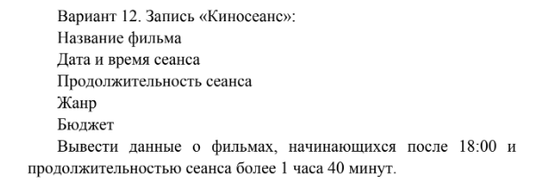
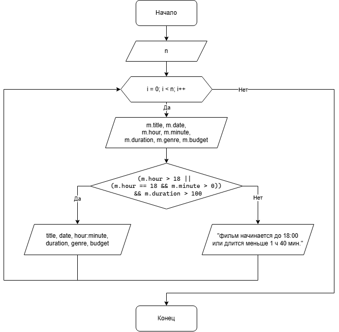

# Домашнее задание к работе 11

## Условие задачи
Вывести данные о фильмах, начинающихся после 18:00 и продолжительностью сеанса более 1 часа 40 минут.



## 1. Алгоритм и блок-схема

### Алгоритм
1. **Начало**
2. Объявить структуру `Film` с полями: `title`, `date`, `hour`, `minute`, `duration`, `genre`, `budget`.
3. Ввести исходные данные:
   - `n` — количество фильмов.
4. Запустить цикл от `0` до `n - 1`:
   - Ввести данные фильма в переменную `m` типа `struct Film`.
   - Проверить условие: `(m.hour > 18 || (m.hour == 18 && m.minute > 0)) && m.duration > 100`.
   - Вывести все данные о фильме если условие выполняется.
   - Иначе вывести сообщение о неподходящем фильме.
5. **Конец**

### Блок-схема



## 2. Реализация программы
```
#define _CRT_SECURE_NO_WARNINGS
#include <stdio.h>
#include <locale.h>

struct Film {
	char title[100];
	char date[20];
	int hour;
	int minute;
	int duration;
	char genre[50];
	float budget;
};

int main()
{
	setlocale(LC_ALL, "RUS");
	int n;
	printf("Введите количество фильмов: ");
	scanf("%d", &n);
	for (int i = 0; i < n; i++)
	{
		struct Film m;
		printf("Название: ");
		scanf(" %99[^\n]", m.title);
		printf("Дата: ");
		scanf(" %19[^\n]", m.date);
		printf("Час начала: ");
		scanf("%d", &m.hour);
		printf("Минуты начала: ");
		scanf("%d", &m.minute);
		printf("Продолжительность (мин): ");
		scanf("%d", &m.duration);
		printf("Жанр: ");
		scanf(" %49[^\n]", m.genre);
		printf("Бюджет: ");
		scanf("%f", &m.budget);

		if ((m.hour > 18 || (m.hour == 18 && m.minute > 0)) && m.duration > 100)
		{
			printf("\n--- Подходящий фильм ---\n");
			printf("Название: %s\n", m.title);
			printf("Дата и время: %s, %02d:%02d\n", m.date, m.hour, m.minute);
			printf("Продолжительность: %d мин.\n", m.duration);
			printf("Жанр: %s\n", m.genre);
			printf("Бюджет: %.2f\n", m.budget);
		}
		else
			printf("фильм начинается до 18:00 или длится меньше 1 часа 40 минут.\n");
	}
	return 0;
}
```

## 3. Результаты работы программы

```
Введите количество фильмов: 2
Название: Пираты Карибского Моря
Дата: 22.04.2023
Час начала: 19
Минуты начала: 37
Продолжительность (мин): 169
Жанр: Фантастика
Бюджет: 12738741982

--- Подходящий фильм ---
Название: Пираты Карибского Моря
Дата и время: 2.04.2023, 19:37
Продолжительность: 169 мин.
Жанр: Фантастика
Бюджет: 12738741982.00
```


## 4. Информация о разработчике

Ляховский Сергей бИЦТ - 262
